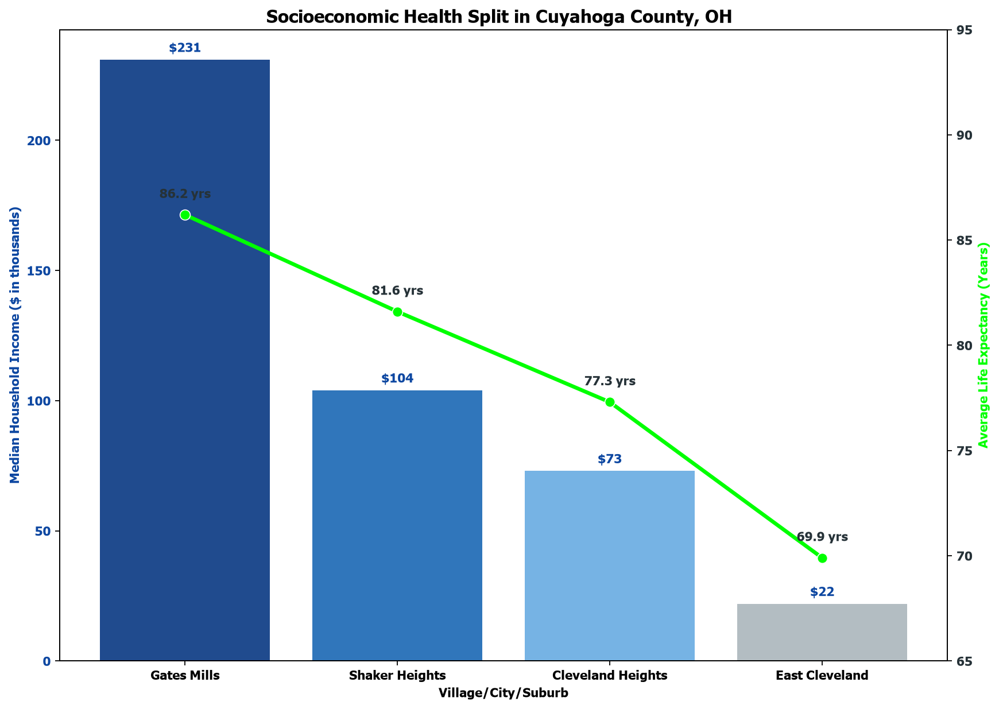

# Cuyahoga County Life Expectancy

`lifeExpectancy.py` creates a chart comparing median household income and
average life expectancy for four communities in Cuyahoga County, Ohio:

- Gates Mills
- Shaker Heights
- Cleveland Heights
- East Cleveland

The chart uses colored bars for median household income (in thousands of
dollars) and a line with point labels for life expectancy (in years). The
values are defined directly in the Python script.



## Requirements

- Python 3
- pandas
- matplotlib
- seaborn

Install the required packages with:

```bash
python -m pip install pandas matplotlib seaborn
```

## Run

From the directory containing `lifeExpectancy.py`, run:

```bash
python lifeExpectancy.py
```

The chart opens in a Matplotlib window. Close the window to finish the script.

## Data

| Community | Median household income (thousands of dollars) | Life expectancy (years) |
|---|---:|---:|
| Gates Mills | 231 | 86.2 |
| Shaker Heights | 104 | 81.6 |
| Cleveland Heights | 73 | 77.3 |
| East Cleveland | 22 | 69.9 |

The script uses a dual y-axis: income is shown on the left and life expectancy
on the right. The figures are provided as a small illustrative dataset in the
script.

## Interpretation

The metrics clearly show that wealthier neighborhoods benefit from superior
healthcare infrastructure and longer average lifespans.
